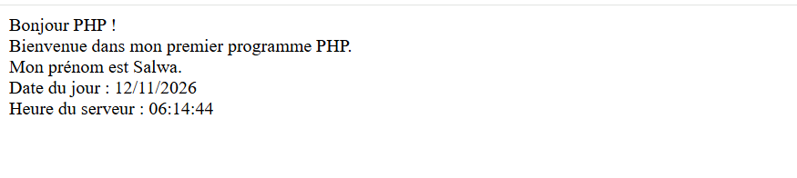
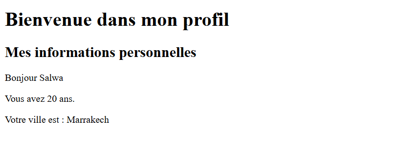
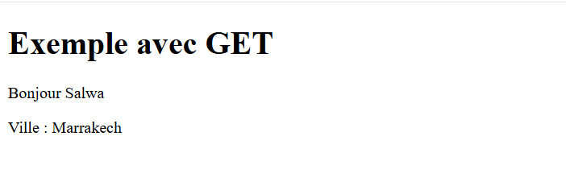
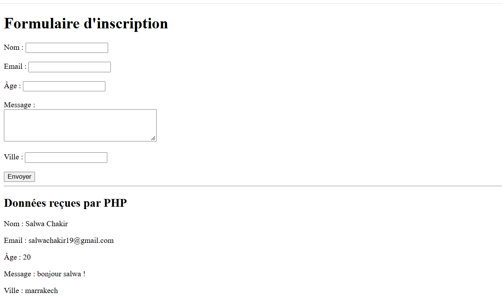
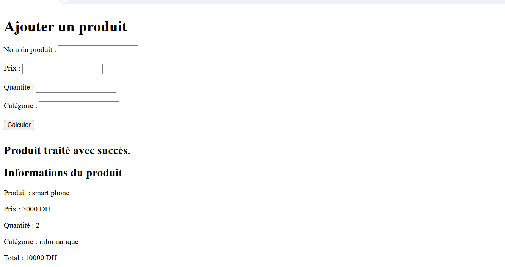
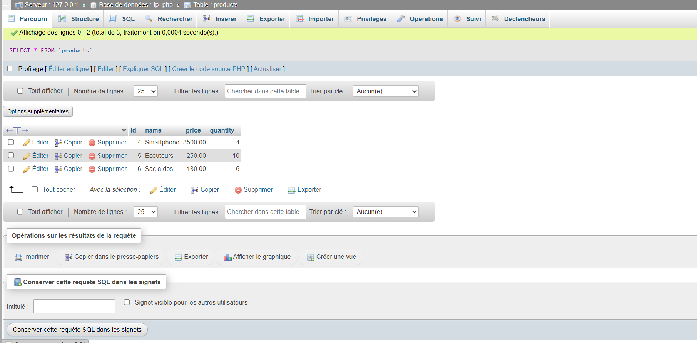
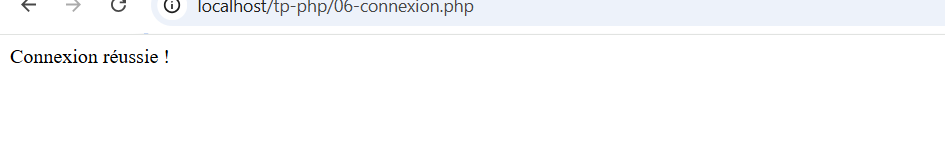
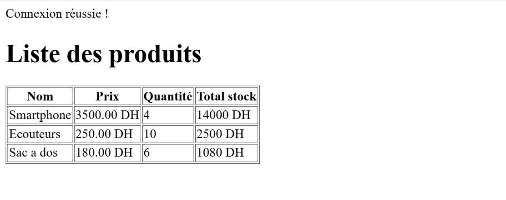

## Description :

Dans ce TP, j'ai travaillé avec PHP et MySQL pour apprendre à créer des pages web dynamiques. J'ai commencé par utiliser les variables et afficher des informations avec PHP, puis j'ai appris à utiliser les formulaires avec les méthodes GET et POST. Ensuite, j'ai créé une base de données MySQL, établi une connexion avec PHP en utilisant PDO et affiché les produits dans un tableau HTML

## Technologies utilisées :
- PHP
- HTML5
- MySQL
- phpMyAdmin
- XAMPP
- Visual Studio Code
## Activités réalisées :
# Activité 1 – Premier script PHP

J'ai utilisé echo pour afficher des messages, ajouté mon prénom et affiché la date et l'heure.

# Activité 2 – PHP et HTML

J'ai utilisé des variables pour afficher mon nom, mon âge et ma ville.

# Activité 3 – Méthode GET

J'ai récupéré le nom et la ville depuis l'URL avec $GET.

# Activité 4 – Méthode POST

J'ai créé un formulaire et utilisé $POST pour récupérer les informations envoyées.

# Activité 5 – Traitement d'un formulaire

J'ai créé un formulaire pour saisir un produit, son prix et sa quantité. PHP calcule le total.

# Activité 6 – Base de données MySQL

J'ai importé la base de données tp_php et vérifié la table products dans phpMyAdmin.

# Activité 7 – Connexion avec PDO

J'ai utilisé PDO pour connecter PHP à la base de données MySQL.

# Activité 8 – Affichage des produits

J'ai utilisé SELECT pour récupérer les produits et les afficher dans un tableau HTML avec le total du stock.

# Bonus – Filtrage des produits

J'ai affiché uniquement les produits dont le prix est supérieur à 300 DH.

